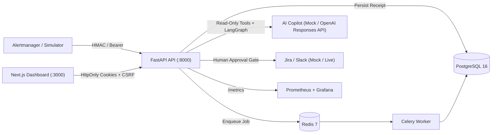
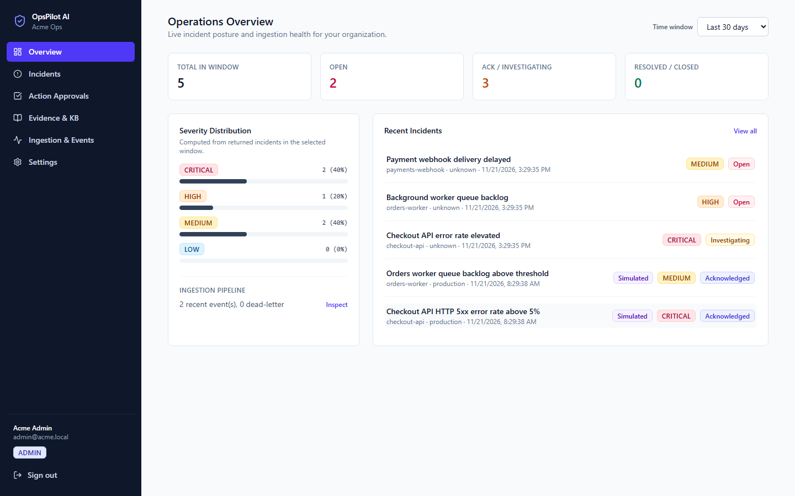
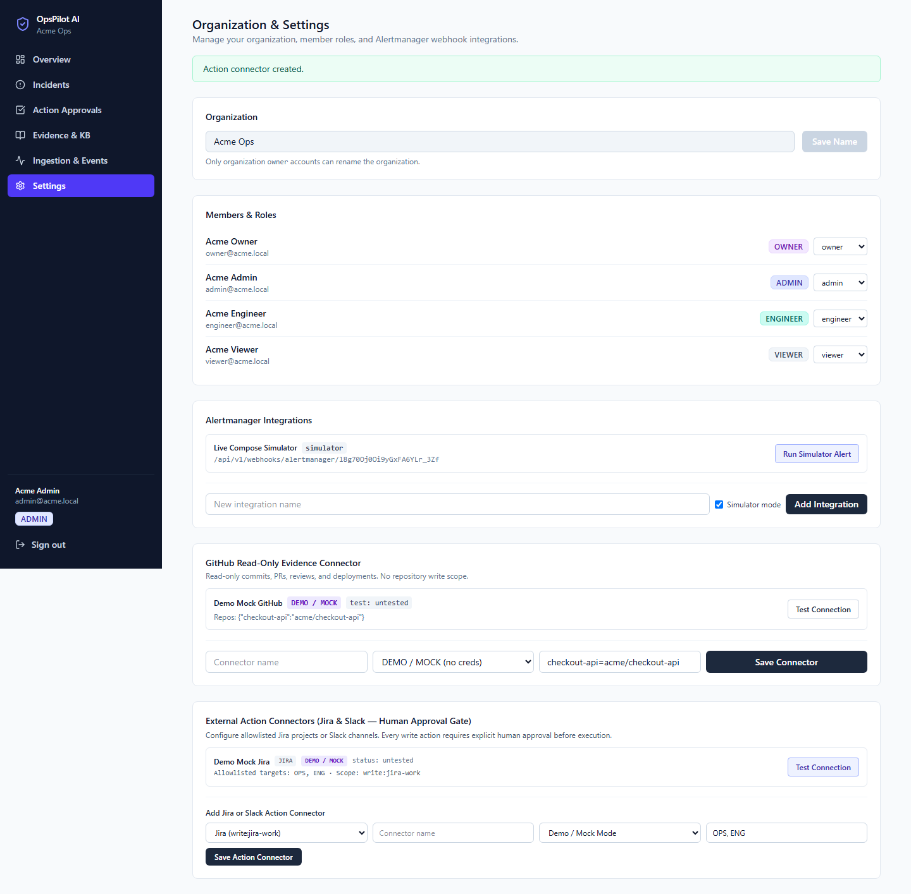
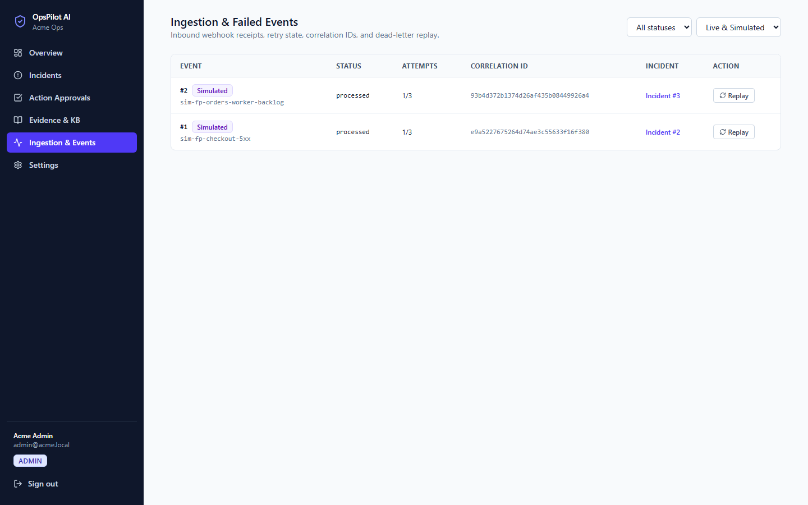
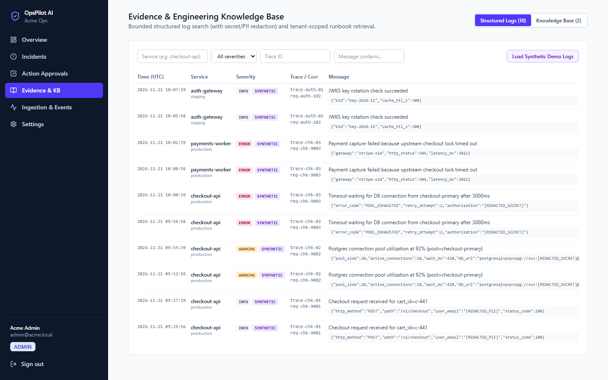
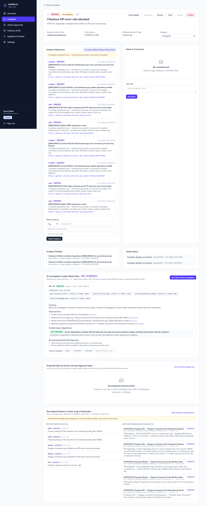
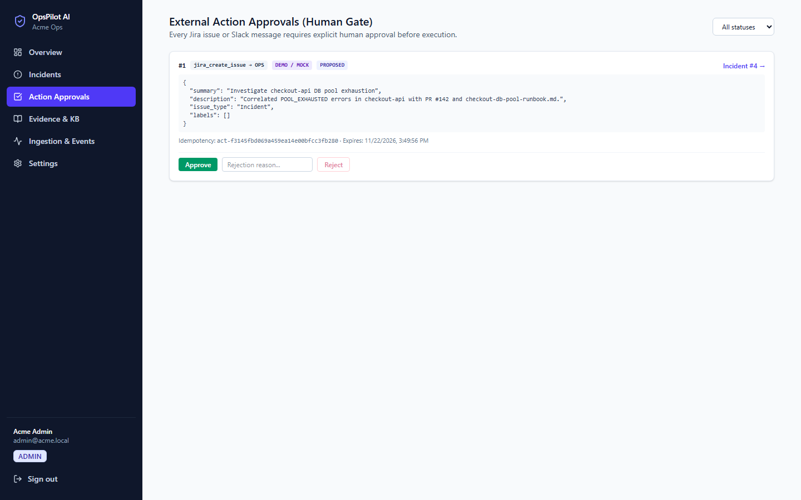

# OpsPilot AI

**Evidence-backed, multi-tenant incident investigation and human-gated workflow automation platform.**

OpsPilot AI ingests monitoring alerts, correlates redacted application logs, read-only GitHub activity, and tenant-scoped runbooks, runs a bounded read-only AI investigation copilot with strict citation verification, and gates every external write (Jira, Slack) behind explicit human approval.

> **Demo & Evaluation Ready (Local / Staging).** Runs 100% locally with deterministic mock adapters and synthetic fixtures (no paid OpenAI, GitHub, Jira, or Slack credentials required). See [docs/SECURITY_THREAT_MODEL.md](docs/SECURITY_THREAT_MODEL.md) and **Known Limitations** below before production deployment.

## Architecture



## Implemented Capabilities (Phases 1–12)

- **Multi-tenant identity & RBAC:** `OWNER`, `ADMIN`, `ENGINEER`, and `VIEWER` roles enforced
  server-side on every protected endpoint ([docs/SECURITY.md](docs/SECURITY.md)).
- **Session security:** Argon2id password hashing, short-lived JWT access tokens + rotating
  opaque refresh tokens (with reuse-detection family revocation) in `HttpOnly` `SameSite=Lax`
  cookies + double-submit `X-CSRF-Token`, narrow CORS, and auth rate limiting.
- **Tenant isolation:** Explicit `organization_id` scoping in `app/repositories/`; cross-tenant
  lookups return `404`.
- **Append-only audit trail:** `audit_logs` records auth, RBAC, invitation, and incident events
  without leaking secrets.
- **Incident domain:** list/filter/search/sort/paginate (`X-Total-Count`), create, update with
  optimistic concurrency (`version` / `If-Match`), enforced lifecycle (`open` → `acknowledged` /
  `investigating` → `resolved` → `closed` + `reopen`), same-org assignment, timeline events,
  comments, evidence references, affected services, tags, and soft-delete archive
  (`/api/v1/incidents`).
- **Event ingestion & queue:** Prometheus Alertmanager v4 webhooks (`/api/v1/webhooks/alertmanager/{token}`)
  with HMAC+timestamp / Bearer auth, encrypted tenant secrets + rotation, persistent receipts
  (`inbound_events`), Redis + Celery worker with exponential backoff/jitter & dead-lettering,
  deterministic incident deduplication, admin replay, and a deterministic simulator.
- **Next.js Operations Dashboard (`frontend/`):** App Router with strict TypeScript, Tailwind CSS,
  cookie/CSRF auth client, Overview dashboard, Incident list/detail, Ingestion & Dead-Letter view,
  and Settings shell.
- **Read-only GitHub evidence connector:** `SourceControlProvider` interface with
  `GitHubClient` (GitHub App or fine-grained PAT, ETags, pagination, rate limits, retries) and
  deterministic `MockGitHubAdapter`, `X-Hub-Signature-256` webhook deduplication, and
  hypothesis-labelled incident correlation (`/api/v1/incidents/{id}/correlate-github`).
- **Evidence layer (logs & engineering KB):** Bounded structured log ingestion/search with
  secret/PII redaction and UTC normalization (`/api/v1/evidence/logs`), tenant-scoped Markdown/text
  knowledge base with upload safety checks, versioning, re-index/delete, hybrid retrieval with
  stable citations and untrusted-content boundaries (`/api/v1/evidence/kb/*`), and `/evidence` UI.
- **Read-only AI investigation copilot:** Bounded LangGraph state machine over 4 allowlisted
  read-only tools (`get_incident_history`, `search_service_logs`, `correlate_github_evidence`,
  `search_knowledge_base`), OpenAI Responses API (`openai`) + deterministic mock mode, strict
  evidence-ID citation validation, per-tenant daily quotas, and incident copilot UI panel.
- **Controlled external write actions:** Human-gated `ProposedAction` workflow for Jira issues
  and Slack messages (`/api/v1/actions/*`), server-side destination allowlists, payload-hash
  integrity, separation of duties, execution-time RBAC re-verification, idempotent retries,
  `DEMO / MOCK` vs `LIVE` connectors, and `/actions` approval queue.
- **Observability & AI evaluation:** OpenTelemetry tracing (FastAPI, SQLAlchemy, Celery, AI runs),
  low-cardinality Prometheus metrics (`/metrics`), opt-in Prometheus + Grafana Compose stack
  (`--profile observability`), alert rules, operational runbooks (`docs/runbooks/`), synthetic
  incident simulator (`scripts/simulate_incident.py`), and offline AI eval harness (`app.evals.runner`).
- **Security & reliability hardening:** SSRF outbound URL guard, security response headers,
  negative security tests (`test_security_hardening.py`), CI dependency/secret scans
  (`.github/workflows/ci.yml`), reproducible load tests (`scripts/load_test.py` +
  `docs/LOAD_TEST_REPORT.md`), threat model (`docs/SECURITY_THREAT_MODEL.md`), and DR/IR runbooks.
- **Alembic + PostgreSQL:** migrations `0001`–`0008` own the schema; `/health/live` and
  `/health/ready` probes; structured JSON/console logs with `X-Request-ID`.

## Requirements

- Python 3.12+
- Docker Desktop (for PostgreSQL / Compose; optional for SQLite-only work)

## 1. Configure environment

From the repository root:

```powershell
Copy-Item .env.example .env      # macOS/Linux: cp .env.example .env
```

Edit `.env` and replace every `replace-with-a-local-password` with a URL-safe password
(letters, digits, `-`, `_`, `.`). `.env` is git-ignored; never commit it.

| Variable | Purpose |
|---|---|
| `POSTGRES_DB`, `POSTGRES_USER`, `POSTGRES_PASSWORD` | Compose PostgreSQL credentials |
| `APP_ENV` | `development` \| `test` \| `production` (production rejects SQLite) |
| `DATABASE_URL` | Used by local (non-Docker) runs; Compose builds its own PostgreSQL URL |
| `LOG_LEVEL`, `LOG_FORMAT` | `INFO`…; `console` \| `json` |
| `FRONTEND_ORIGIN` | Allowed CORS origin |
| `TEST_POSTGRES_URL` | Enables PostgreSQL integration tests |

## 2. Run with Docker Compose (PostgreSQL)

```powershell
docker compose up --build -d     # db (healthy) -> migrate (alembic upgrade head) -> api
docker compose ps                # api and db should be "healthy"; migrate "exited (0)"
curl.exe -i http://127.0.0.1:8000/health/ready
```

- API docs: http://127.0.0.1:8000/docs
- Logs: `docker compose logs -f api`
- DB connectivity from inside the stack: `docker compose exec api python -m app.db_check`
- psql shell: `docker compose exec db sh -c 'psql -U "$POSTGRES_USER" "$POSTGRES_DB"'`
- Seed local demo organizations & users (CLI-only, blocked in production):
  `docker compose exec api python -m app.bootstrap`
- Seed demo incidents into `acme-ops`: `docker compose exec api python seed_demo.py`

Stop (data is kept in the `opspilot_postgres_data` volume):

```powershell
docker compose stop      # or: docker compose down   (removes containers, keeps the volume)
```

> [!CAUTION]
> `docker compose down -v` **deletes the database volume and all data**. Don't use it unless
> you intend to wipe the local database.

## 3. Run locally without Docker (SQLite)

```powershell
cd backend
python -m venv .venv
.\.venv\Scripts\Activate.ps1          # macOS/Linux: source .venv/bin/activate
pip install -r requirements-dev.txt
alembic upgrade head                   # creates/updates the database in DATABASE_URL
python -m app.bootstrap                # creates demo orgs (acme-ops, beta-ops) & users
python seed_demo.py                    # optional demo incidents
uvicorn app.main:app --reload
```

`DATABASE_URL=sqlite:///./opspilot.db` resolves relative to `backend/`.
**Existing `opspilot.db` created before Phase 1** already has the `incidents` table but no
Alembic history, so `alembic upgrade head` fails with "table incidents already exists".
The schema is identical to revision `0001`, so adopt it with `alembic stamp 0001`
(or move the file aside and run `alembic upgrade head` + `python seed_demo.py`).

To run locally against a PostgreSQL server you manage, set
`DATABASE_URL=postgresql+psycopg://<user>:<password>@<host>:5432/<db>` and run
`alembic upgrade head`.

## 4. Database migrations (Alembic)

Run from `backend/`; the target database is taken from `DATABASE_URL`.

```powershell
alembic current                          # applied revision
alembic upgrade head                     # apply all migrations
alembic downgrade -1                     # roll back one revision
alembic revision --autogenerate -m "add x"   # new migration; review before committing
alembic check                            # fails if models and migrations have drifted
```

Rules: every model change ships with a reviewed migration that has a working `downgrade()`.
In Compose, migrations run automatically in the `migrate` service.

## 5. Tests and quality checks

From `backend/` with the venv active:

```powershell
.\scripts\check.ps1                      # ruff check + ruff format --check + mypy + pytest
pytest -v                                # tests only
pytest --cov=app --cov-report=term-missing
```

Default tests use in-memory SQLite and never touch `.env` databases or `opspilot.db`.

**PostgreSQL integration tests** (`@pytest.mark.postgres`) run against an ephemeral
database and are reported as **SKIPPED** when `TEST_POSTGRES_URL` is not set:

```powershell
docker compose --profile test up -d db-test   # tmpfs-backed, 127.0.0.1:55432
# TEST_POSTGRES_URL in .env (or the shell) must point at .../opspilot_test
pytest -v -m postgres
docker compose --profile test stop db-test
```

The test database name must end in `_test`; the tests reset its schema.

## 6. Run the Next.js Frontend (`frontend/`)

From `frontend/` (with the backend running on `http://localhost:8000` and demo accounts
bootstrapped via `python -m app.bootstrap`):

```powershell
Copy-Item .env.example .env.local
npm install
npm run dev                 # http://localhost:3000
```

Quality & E2E checks from `frontend/`:

```powershell
npm run typecheck           # tsc --noEmit
npm run lint                # eslint
npm run test                # vitest unit/component tests
npm run build               # next build
npx playwright test         # desktop (1280x800) + mobile (390x844) E2E
```

## Repository map

```text
opspilot-ai/
├── backend/
│   ├── app/
│   │   ├── api/
│   │   │   ├── v1/incidents.py     # thin HTTP router (/api/v1/incidents)
│   │   │   ├── health.py           # /health/live, /health/ready
│   │   │   ├── errors.py           # exception -> ErrorResponse mapping
│   │   │   └── middleware.py       # request ID, access log, 500 boundary
│   │   ├── core/                   # config, database, logging, domain errors
│   │   ├── models/incident.py      # SQLAlchemy model + enums
│   │   ├── schemas/                # Pydantic v2 request/response models
│   │   ├── services/incidents.py   # use cases, transaction boundaries
│   │   ├── db_check.py             # python -m app.db_check
│   │   └── main.py                 # create_app() / app
│   ├── alembic/                    # migrations (authoritative schema)
│   ├── tests/
│   ├── scripts/check.ps1
│   ├── Dockerfile
│   ├── requirements.txt            # runtime
│   └── requirements-dev.txt        # runtime + test/lint tools
├── docs/                           # spec, architecture, tracker, ADRs
├── docker-compose.yml
├── .env.example                    # placeholders only
└── AGENTS.md                       # engineering contract
```

## API quick reference

| Method | Path | Notes |
|---|---|---|
| GET | `/health/live` | 200 `{"status":"ok"}` |
| GET | `/health/ready` | 200 `ready` / 503 `not_ready` |
| GET | `/health` | Deprecated legacy check |
| GET | `/api/v1/incidents?limit=50` | Newest first, `limit` 1–100 |
| POST | `/api/v1/incidents` | 201 |
| GET | `/api/v1/incidents/{id}` | 404 if missing |
| PATCH | `/api/v1/incidents/{id}/status` | `open`/`investigating`/`resolved`/`closed` |

```powershell
curl.exe -X POST http://127.0.0.1:8000/api/v1/incidents -H "Content-Type: application/json" `
  -d '{\"title\":\"Checkout API returns errors\",\"service\":\"checkout-api\",\"severity\":\"high\"}'
```

## Troubleshooting

| Symptom | Fix |
|---|---|
| `failed to connect to the docker API ... dockerDesktopLinuxEngine` | Start Docker Desktop and wait until `docker info` succeeds. |
| `required variable POSTGRES_PASSWORD is missing` | Create `.env` from `.env.example` in the repo root. |
| `password authentication failed` after changing `.env` | The volume keeps its original password. Restore the old value, or run `ALTER USER <user> PASSWORD '<new>'` via the psql shell. Don't delete the volume to "fix" this. |

## Recruiter & Demo Documentation

- **Live Demo Script (5–7 min):** [docs/DEMO_SCRIPT.md](docs/DEMO_SCRIPT.md)
- **Engineering Case Study:** [docs/ENGINEERING_CASE_STUDY.md](docs/ENGINEERING_CASE_STUDY.md)
- **Feature Traceability Matrix:** [docs/TRACEABILITY_MATRIX.md](docs/TRACEABILITY_MATRIX.md)
- **Cloud Deployment Blueprint (AWS ECS Fargate):** [docs/DEPLOYMENT_AWS_ECS.md](docs/DEPLOYMENT_AWS_ECS.md)
- **Security Threat Model & Load Report:** [docs/SECURITY_THREAT_MODEL.md](docs/SECURITY_THREAT_MODEL.md), [docs/LOAD_TEST_REPORT.md](docs/LOAD_TEST_REPORT.md)

## Screenshots

Captured from the running `docker compose --profile demo up -d` stack following [docs/DEMO_SCRIPT.md](docs/DEMO_SCRIPT.md):

### Operations Overview


### Settings & Integrations (Alertmanager Simulator, Mock GitHub, Mock Jira)


### Ingestion & Events (Receipts, Correlation IDs, Replay)


### Evidence & Hybrid Knowledge Base Search


### Incident Detail & Read-Only AI Investigation Copilot (`[EV-*]` Citations)


### External Action Approvals (Human Gate & Payload Preview)


## Known Limitations

- **Single-process in-memory rate limiter:** `RateLimiter` is in-memory per API process; multi-replica deployments should swap in a Redis-backed limiter.
- **Knowledge Base file formats:** Supports UTF-8 `.md` and `.txt` only (PDF deferred); local upload checks do not bundle an external AV daemon (e.g., ClamAV).
- **OTel SQLAlchemy span wrapping:** `opentelemetry-instrumentation-sqlalchemy 0.66b2` skips automatic wrapping on `sqlalchemy 2.1.9` (`< 2.1.0` constraint); HTTP, Celery worker, connector, and AI spans are active.
| `/health/ready` returns 503 | Database unreachable: `docker compose ps db`, `docker compose logs db`, `docker compose exec api python -m app.db_check`. |
| `migrate` exited non-zero / api never starts | `docker compose logs migrate`. |
| `table incidents already exists` (SQLite) | Pre-Phase-1 database: `alembic stamp 0001` (see §3). |
| Port 8000 or 55432 already in use | Stop the other process, or change the port mapping / `TEST_POSTGRES_PORT`. |
| PostgreSQL tests SKIPPED | `TEST_POSTGRES_URL` not set — this is expected without Docker. |
| `Activate.ps1 cannot be loaded` | `Set-ExecutionPolicy -Scope CurrentUser RemoteSigned`. |
